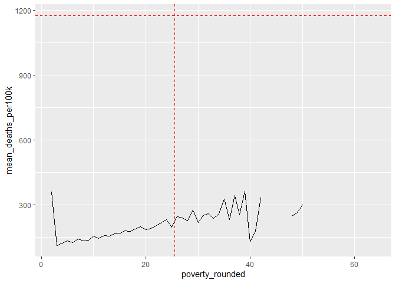
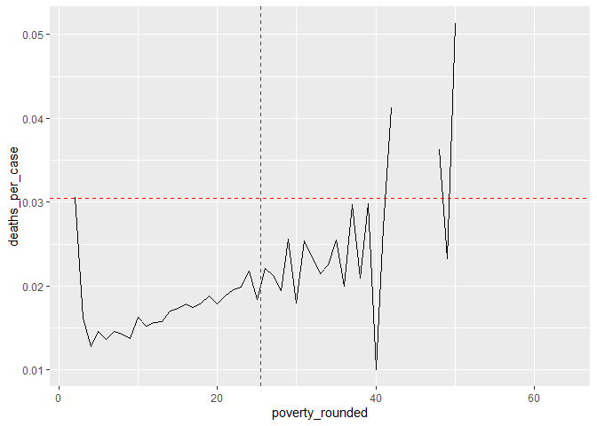

COVID-19
================
(Your name here)
2020-

- [Grading Rubric](#grading-rubric)
  - [Individual](#individual)
  - [Submission](#submission)
- [The Big Picture](#the-big-picture)
- [Get the Data](#get-the-data)
  - [Navigating the Census Bureau](#navigating-the-census-bureau)
    - [**q1** Load Table `B01003` into the following tibble. Make sure
      the column names are
      `id, Geographic Area Name, Estimate!!Total, Margin of Error!!Total`.](#q1-load-table-b01003-into-the-following-tibble-make-sure-the-column-names-are-id-geographic-area-name-estimatetotal-margin-of-errortotal)
  - [Automated Download of NYT Data](#automated-download-of-nyt-data)
    - [**q2** Visit the NYT GitHub repo and find the URL for the **raw**
      US County-level data. Assign that URL as a string to the variable
      below.](#q2-visit-the-nyt-github-repo-and-find-the-url-for-the-raw-us-county-level-data-assign-that-url-as-a-string-to-the-variable-below)
- [Join the Data](#join-the-data)
  - [**q3** Process the `id` column of `df_pop` to create a `fips`
    column.](#q3-process-the-id-column-of-df_pop-to-create-a-fips-column)
  - [**q4** Join `df_covid` with `df_q3` by the `fips` column. Use the
    proper type of join to preserve *only* the rows in
    `df_covid`.](#q4-join-df_covid-with-df_q3-by-the-fips-column-use-the-proper-type-of-join-to-preserve-only-the-rows-in-df_covid)
- [Analyze](#analyze)
  - [Normalize](#normalize)
    - [**q5** Use the `population` estimates in `df_data` to normalize
      `cases` and `deaths` to produce per 100,000 counts \[3\]. Store
      these values in the columns `cases_per100k` and
      `deaths_per100k`.](#q5-use-the-population-estimates-in-df_data-to-normalize-cases-and-deaths-to-produce-per-100000-counts-3-store-these-values-in-the-columns-cases_per100k-and-deaths_per100k)
  - [Guided EDA](#guided-eda)
    - [**q6** Compute some summaries](#q6-compute-some-summaries)
    - [**q7** Find and compare the top
      10](#q7-find-and-compare-the-top-10)
  - [Self-directed EDA](#self-directed-eda)
    - [**q8** Drive your own ship: You’ve just put together a very rich
      dataset; you now get to explore! Pick your own direction and
      generate at least one punchline figure to document an interesting
      finding. I give a couple tips & ideas
      below:](#q8-drive-your-own-ship-youve-just-put-together-a-very-rich-dataset-you-now-get-to-explore-pick-your-own-direction-and-generate-at-least-one-punchline-figure-to-document-an-interesting-finding-i-give-a-couple-tips--ideas-below)
    - [Ideas](#ideas)
    - [Aside: Some visualization
      tricks](#aside-some-visualization-tricks)
    - [Geographic exceptions](#geographic-exceptions)
- [Notes](#notes)

*Purpose*: In this challenge, you’ll learn how to navigate the U.S.
Census Bureau website, programmatically download data from the internet,
and perform a county-level population-weighted analysis of current
COVID-19 trends. This will give you the base for a very deep
investigation of COVID-19, which we’ll build upon for Project 1.

<!-- include-rubric -->

# Grading Rubric

<!-- -------------------------------------------------- -->

Unlike exercises, **challenges will be graded**. The following rubrics
define how you will be graded, both on an individual and team basis.

## Individual

<!-- ------------------------- -->

| Category | Needs Improvement | Satisfactory |
|----|----|----|
| Effort | Some task **q**’s left unattempted | All task **q**’s attempted |
| Observed | Did not document observations, or observations incorrect | Documented correct observations based on analysis |
| Supported | Some observations not clearly supported by analysis | All observations clearly supported by analysis (table, graph, etc.) |
| Assessed | Observations include claims not supported by the data, or reflect a level of certainty not warranted by the data | Observations are appropriately qualified by the quality & relevance of the data and (in)conclusiveness of the support |
| Specified | Uses the phrase “more data are necessary” without clarification | Any statement that “more data are necessary” specifies which *specific* data are needed to answer what *specific* question |
| Code Styled | Violations of the [style guide](https://style.tidyverse.org/) hinder readability | Code sufficiently close to the [style guide](https://style.tidyverse.org/) |

## Submission

<!-- ------------------------- -->

Make sure to commit both the challenge report (`report.md` file) and
supporting files (`report_files/` folder) when you are done! Then submit
a link to Canvas. **Your Challenge submission is not complete without
all files uploaded to GitHub.**

``` r
library(tidyverse)
```

    ## ── Attaching core tidyverse packages ──────────────────────── tidyverse 2.0.0 ──
    ## ✔ dplyr     1.2.1     ✔ readr     2.2.0
    ## ✔ forcats   1.0.1     ✔ stringr   1.6.0
    ## ✔ ggplot2   4.0.3     ✔ tibble    3.3.1
    ## ✔ lubridate 1.9.5     ✔ tidyr     1.3.2
    ## ✔ purrr     1.2.2     
    ## ── Conflicts ────────────────────────────────────────── tidyverse_conflicts() ──
    ## ✖ dplyr::filter() masks stats::filter()
    ## ✖ dplyr::lag()    masks stats::lag()
    ## ℹ Use the conflicted package (<http://conflicted.r-lib.org/>) to force all conflicts to become errors

*Background*:
[COVID-19](https://en.wikipedia.org/wiki/Coronavirus_disease_2019) is
the disease caused by the virus SARS-CoV-2. In 2020 it became a global
pandemic, leading to huge loss of life and tremendous disruption to
society. The New York Times (as of writing) publishes up-to-date data on
the progression of the pandemic across the United States—we will study
these data in this challenge.

*Optional Readings*: I’ve found this [ProPublica
piece](https://www.propublica.org/article/how-to-understand-covid-19-numbers)
on “How to understand COVID-19 numbers” to be very informative!

# The Big Picture

<!-- -------------------------------------------------- -->

We’re about to go through *a lot* of weird steps, so let’s first fix the
big picture firmly in mind:

We want to study COVID-19 in terms of data: both case counts (number of
infections) and deaths. We’re going to do a county-level analysis in
order to get a high-resolution view of the pandemic. Since US counties
can vary widely in terms of their population, we’ll need population
estimates in order to compute infection rates (think back to the
`Titanic` challenge).

That’s the high-level view; now let’s dig into the details.

# Get the Data

<!-- -------------------------------------------------- -->

1.  County-level population estimates (Census Bureau)
2.  County-level COVID-19 counts (New York Times)

## Navigating the Census Bureau

<!-- ------------------------- -->

**Steps**: Our objective is to find the 2018 American Community
Survey\[1\] (ACS) Total Population estimates, disaggregated by counties.
To check your results, this is Table `B01003`.

1.  Go to [data.census.gov](data.census.gov).
2.  Scroll down and click `View Tables`.
3.  Apply filters to find the ACS **Total Population** estimates,
    disaggregated by counties. I used the filters:

- `Topics > Populations and People > Counts, Estimates, and Projections > Population Total`
- `Geography > County > All counties in United States`

5.  Select the **Total Population** table and click the `Download`
    button to download the data; make sure to select the 2018 5-year
    estimates.
6.  Unzip and move the data to your `challenges/data` folder.

- Note that the data will have a crazy-long filename like
  `ACSDT5Y2018.B01003_data_with_overlays_2020-07-26T094857.csv`. That’s
  because metadata is stored in the filename, such as the year of the
  estimate (`Y2018`) and my access date (`2020-07-26`). **Your filename
  will vary based on when you download the data**, so make sure to copy
  the filename that corresponds to what you downloaded!

### **q1** Load Table `B01003` into the following tibble. Make sure the column names are `id, Geographic Area Name, Estimate!!Total, Margin of Error!!Total`.

*Hint*: You will need to use the `skip` keyword when loading these data!

``` r
## TASK: Load the census bureau data with the following tibble name.
filename = "./data/ACSDT5Y2018.B01003-Data.csv"
df_pop <- read.csv(filename, skip = 1) |> # Skip first row of data 
  rename(
    "id" = "Geography",
    "Geographic Area Name" = "Geographic.Area.Name",
    "Estimate!!Total" = "Estimate..Total",
    "Margin of Error!!Total" = "Margin.of.Error..Total"
  ) |> 
  select(-c("X")) # Remove extra columns
```

*Note*: You can find information on 1-year, 3-year, and 5-year estimates
[here](https://www.census.gov/programs-surveys/acs/guidance/estimates.html).
The punchline is that 5-year estimates are more reliable but less
current.

## Automated Download of NYT Data

<!-- ------------------------- -->

ACS 5-year estimates don’t change all that often, but the COVID-19 data
are changing rapidly. To that end, it would be nice to be able to
*programmatically* download the most recent data for analysis; that way
we can update our analysis whenever we want simply by re-running our
notebook. This next problem will have you set up such a pipeline.

The New York Times is publishing up-to-date data on COVID-19 on
[GitHub](https://github.com/nytimes/covid-19-data).

### **q2** Visit the NYT [GitHub](https://github.com/nytimes/covid-19-data) repo and find the URL for the **raw** US County-level data. Assign that URL as a string to the variable below.

``` r
## TASK: Find the URL for the NYT covid-19 county-level data
url_counties <- "https://raw.githubusercontent.com/nytimes/covid-19-data/master/us-counties.csv"
```

Once you have the url, the following code will download a local copy of
the data, then load the data into R.

``` r
## NOTE: No need to change this; just execute
## Set the filename of the data to download
filename_nyt <- "./data/nyt_counties.csv"

## Download the data locally
curl::curl_download(
        url_counties,
        destfile = filename_nyt
      )

## Loads the downloaded csv
df_covid <- read_csv(filename_nyt)
```

    ## Rows: 2502832 Columns: 6
    ## ── Column specification ────────────────────────────────────────────────────────
    ## Delimiter: ","
    ## chr  (3): county, state, fips
    ## dbl  (2): cases, deaths
    ## date (1): date
    ## 
    ## ℹ Use `spec()` to retrieve the full column specification for this data.
    ## ℹ Specify the column types or set `show_col_types = FALSE` to quiet this message.

You can now re-run the chunk above (or the entire notebook) to pull the
most recent version of the data. Thus you can periodically re-run this
notebook to check in on the pandemic as it evolves.

*Note*: You should feel free to copy-paste the code above for your own
future projects!

# Join the Data

<!-- -------------------------------------------------- -->

To get a sense of our task, let’s take a glimpse at our two data
sources.

``` r
## NOTE: No need to change this; just execute
df_pop %>% glimpse
```

    ## Rows: 3,220
    ## Columns: 4
    ## $ id                       <chr> "0500000US01001", "0500000US01003", "0500000U…
    ## $ `Geographic Area Name`   <chr> "Autauga County, Alabama", "Baldwin County, A…
    ## $ `Estimate!!Total`        <int> 55200, 208107, 25782, 22527, 57645, 10352, 20…
    ## $ `Margin of Error!!Total` <chr> "*****", "*****", "*****", "*****", "*****", …

``` r
df_covid %>% glimpse
```

    ## Rows: 2,502,832
    ## Columns: 6
    ## $ date   <date> 2020-01-21, 2020-01-22, 2020-01-23, 2020-01-24, 2020-01-24, 20…
    ## $ county <chr> "Snohomish", "Snohomish", "Snohomish", "Cook", "Snohomish", "Or…
    ## $ state  <chr> "Washington", "Washington", "Washington", "Illinois", "Washingt…
    ## $ fips   <chr> "53061", "53061", "53061", "17031", "53061", "06059", "17031", …
    ## $ cases  <dbl> 1, 1, 1, 1, 1, 1, 1, 1, 1, 1, 1, 1, 1, 1, 1, 1, 1, 1, 1, 1, 1, …
    ## $ deaths <dbl> 0, 0, 0, 0, 0, 0, 0, 0, 0, 0, 0, 0, 0, 0, 0, 0, 0, 0, 0, 0, 0, …

To join these datasets, we’ll need to use [FIPS county
codes](https://en.wikipedia.org/wiki/FIPS_county_code).\[2\] The last
`5` digits of the `id` column in `df_pop` is the FIPS county code, while
the NYT data `df_covid` already contains the `fips`.

### **q3** Process the `id` column of `df_pop` to create a `fips` column.

``` r
## TASK: Create a `fips` column by extracting the county code
df_q3 <- df_pop |>
  mutate(fips = str_sub(id, -5))
```

Use the following test to check your answer.

``` r
## NOTE: No need to change this
## Check known county
assertthat::assert_that(
              (df_q3 %>%
              filter(str_detect(`Geographic Area Name`, "Autauga County")) %>%
              pull(fips)) == "01001"
            )
```

    ## [1] TRUE

``` r
print("Very good!")
```

    ## [1] "Very good!"

### **q4** Join `df_covid` with `df_q3` by the `fips` column. Use the proper type of join to preserve *only* the rows in `df_covid`.

``` r
## TASK: Join df_covid and df_q3 by fips.
df_q4 <- left_join(df_covid, df_q3, by="fips")
```

Use the following test to check your answer.

``` r
## NOTE: No need to change this
if (!any(df_q4 %>% pull(fips) %>% str_detect(., "02105"), na.rm = TRUE)) {
  assertthat::assert_that(TRUE)
} else {
  print(str_c(
    "Your df_q4 contains a row for the Hoonah-Angoon Census Area (AK),",
    "which is not in df_covid. You used the incorrect join type.",
    sep = " "
  ))
  assertthat::assert_that(FALSE)
}
```

    ## [1] TRUE

``` r
if (any(df_q4 %>% pull(fips) %>% str_detect(., "78010"), na.rm = TRUE)) {
  assertthat::assert_that(TRUE)
} else {
  print(str_c(
    "Your df_q4 does not include St. Croix, US Virgin Islands,",
    "which is in df_covid. You used the incorrect join type.",
    sep = " "
  ))
  assertthat::assert_that(FALSE)
}
```

    ## [1] TRUE

``` r
print("Very good!")
```

    ## [1] "Very good!"

For convenience, I down-select some columns and produce more convenient
column names.

``` r
## NOTE: No need to change; run this to produce a more convenient tibble
df_data <-
  df_q4 %>%
  select(
    date,
    county,
    state,
    fips,
    cases,
    deaths,
    population = `Estimate!!Total`
  )
```

# Analyze

<!-- -------------------------------------------------- -->

Now that we’ve done the hard work of loading and wrangling the data, we
can finally start our analysis. Our first step will be to produce county
population-normalized cases and death counts. Then we will explore the
data.

## Normalize

<!-- ------------------------- -->

### **q5** Use the `population` estimates in `df_data` to normalize `cases` and `deaths` to produce per 100,000 counts \[3\]. Store these values in the columns `cases_per100k` and `deaths_per100k`.

``` r
## TASK: Normalize cases and deaths
df_normalized <- df_data |> 
  mutate(cases_per100k = (cases / (population / 100000)),
         deaths_per100k = (deaths / (population / 100000))) 
```

You may use the following test to check your work.

``` r
## NOTE: No need to change this
## Check known county data
if (any(df_normalized %>% pull(date) %>% str_detect(., "2020-01-21"))) {
  assertthat::assert_that(TRUE)
} else {
  print(str_c(
    "Date 2020-01-21 not found; did you download the historical data (correct),",
    "or just the most recent data (incorrect)?",
    sep = " "
  ))
  assertthat::assert_that(FALSE)
}
```

    ## [1] TRUE

``` r
if (any(df_normalized %>% pull(date) %>% str_detect(., "2022-05-13"))) {
  assertthat::assert_that(TRUE)
} else {
  print(str_c(
    "Date 2022-05-13 not found; did you download the historical data (correct),",
    "or a single year's data (incorrect)?",
    sep = " "
  ))
  assertthat::assert_that(FALSE)
}
```

    ## [1] TRUE

``` r
## Check datatypes
assertthat::assert_that(is.numeric(df_normalized$cases))
```

    ## [1] TRUE

``` r
assertthat::assert_that(is.numeric(df_normalized$deaths))
```

    ## [1] TRUE

``` r
assertthat::assert_that(is.numeric(df_normalized$population))
```

    ## [1] TRUE

``` r
assertthat::assert_that(is.numeric(df_normalized$cases_per100k))
```

    ## [1] TRUE

``` r
assertthat::assert_that(is.numeric(df_normalized$deaths_per100k))
```

    ## [1] TRUE

``` r
## Check that normalization is correct
assertthat::assert_that(
              abs(df_normalized %>%
               filter(
                 str_detect(county, "Snohomish"),
                 date == "2020-01-21"
               ) %>%
              pull(cases_per100k) - 0.127) < 1e-3
            )
```

    ## [1] TRUE

``` r
assertthat::assert_that(
              abs(df_normalized %>%
               filter(
                 str_detect(county, "Snohomish"),
                 date == "2020-01-21"
               ) %>%
              pull(deaths_per100k) - 0) < 1e-3
            )
```

    ## [1] TRUE

``` r
print("Excellent!")
```

    ## [1] "Excellent!"

## Guided EDA

<!-- ------------------------- -->

Before turning you loose, let’s complete a couple guided EDA tasks.

### **q6** Compute some summaries

Compute the mean and standard deviation for `cases_per100k` and
`deaths_per100k`. *Make sure to carefully choose **which rows** to
include in your summaries,* and justify why!

``` r
## TASK: Compute mean and sd for cases_per100k and deaths_per100k
max_date <- max(df_normalized$date)

df_summary_deaths <- df_normalized |>
  filter(date == max_date) |>
  summarize(
    mean_deaths = mean(deaths_per100k, na.rm = TRUE),
    std_deaths  = sd(deaths_per100k, na.rm = TRUE)
  )

mean_deaths_per100k    <- df_summary_deaths$mean_deaths
std_dev_deaths_per100k <- df_summary_deaths$std_deaths

df_summary_cases <- df_normalized |>
  filter(date == max_date) |>
  summarize(
    mean_cases = mean(cases_per100k, na.rm = TRUE),
    std_cases  = sd(cases_per100k, na.rm = TRUE)
  )

mean_cases_per100k    <- df_summary_cases$mean_cases
std_dev_cases_per100k <- df_summary_cases$std_cases
mean_cases_per100k
```

    ## [1] 24773.98

``` r
mean_deaths_per100k
```

    ## [1] 375.1242

- Which rows did you pick?
  - I picked only rows with the most recent date.
- Why?
  - Firstly there was data from the same county at different timestamps.
    Also, the data accumulated over time so each time stamp is not cases
    in that given period, it’s total up until that point. Therefore if
    you pull the latest date it will be the most updated and you can
    filter to only pull one row per country as each county only has one
    entry per date.

### **q7** Find and compare the top 10

Find the top 10 counties in terms of `cases_per100k`, and the top 10 in
terms of `deaths_per100k`. Report the population of each county along
with the per-100,000 counts. Compare the counts against the mean values
you found in q6. Note any observations.

``` r
## TASK: Find the top 10 max cases_per100k counties; report populations as well
cases_sorted <- df_normalized |> 
  filter(date == max_date) |>
  arrange(desc(cases_per100k))
head(cases_sorted, 10)
```

    ## # A tibble: 10 × 9
    ##    date       county           state fips  cases deaths population cases_per100k
    ##    <date>     <chr>            <chr> <chr> <dbl>  <dbl>      <int>         <dbl>
    ##  1 2022-05-13 Loving           Texas 48301   196      1        102       192157.
    ##  2 2022-05-13 Chattahoochee    Geor… 13053  7486     22      10767        69527.
    ##  3 2022-05-13 Nome Census Area Alas… 02180  6245      5       9925        62922.
    ##  4 2022-05-13 Northwest Arcti… Alas… 02188  4837     13       7734        62542.
    ##  5 2022-05-13 Crowley          Colo… 08025  3347     30       5630        59449.
    ##  6 2022-05-13 Bethel Census A… Alas… 02050 10362     41      18040        57439.
    ##  7 2022-05-13 Dewey            Sout… 46041  3139     44       5779        54317.
    ##  8 2022-05-13 Dimmit           Texas 48127  5760     51      10663        54019.
    ##  9 2022-05-13 Jim Hogg         Texas 48247  2648     22       5282        50133.
    ## 10 2022-05-13 Kusilvak Census… Alas… 02158  4084     14       8198        49817.
    ## # ℹ 1 more variable: deaths_per100k <dbl>

``` r
## TASK: Find the top 10 deaths_per100k counties; report populations as well
deaths_sorted <- df_normalized |> 
  filter(date == max_date) |>
  arrange(desc(deaths_per100k))
head(deaths_sorted, 10)
```

    ## # A tibble: 10 × 9
    ##    date       county           state fips  cases deaths population cases_per100k
    ##    <date>     <chr>            <chr> <chr> <dbl>  <dbl>      <int>         <dbl>
    ##  1 2022-05-13 McMullen         Texas 48311   169      9        662        25529.
    ##  2 2022-05-13 Galax city       Virg… 51640  2561     78       6638        38581.
    ##  3 2022-05-13 Motley           Texas 48345   286     13       1156        24740.
    ##  4 2022-05-13 Hancock          Geor… 13141  1587     90       8535        18594.
    ##  5 2022-05-13 Emporia city     Virg… 51595  1187     55       5381        22059.
    ##  6 2022-05-13 Towns            Geor… 13281  2400    116      11417        21021.
    ##  7 2022-05-13 Jerauld          Sout… 46073   415     20       2029        20453.
    ##  8 2022-05-13 Loving           Texas 48301   196      1        102       192157.
    ##  9 2022-05-13 Robertson        Kent… 21201   672     21       2143        31358.
    ## 10 2022-05-13 Martinsville ci… Virg… 51690  3478    124      13101        26548.
    ## # ℹ 1 more variable: deaths_per100k <dbl>

**Observations**:

- All of the highest deaths and cases were in small counties where the
  population was under 20k, usually way under that.
- All but 1 (Loving) of the top 10 counties for cases did not appear on the
  top 10 counties for deaths, I would have expected more
  overlap.
- Texas counties had both the highest ratio of deaths and cases (Loving
  for cases, McMullen for deaths)
- When did these “largest values” occur?
  - The largest value of cases per 100k occured when there were more
    cases than people in Loving, TX where there were 196 cases and only
    100 people.
  - This was somewhat similar for deaths with McMullen, TX where there
    were 662 people and 9 deaths.
  - Even a single death in a small town creates a wildly high ratio
    because of its small size.

## Self-directed EDA

<!-- ------------------------- -->

### **q8** Drive your own ship: You’ve just put together a very rich dataset; you now get to explore! Pick your own direction and generate at least one punchline figure to document an interesting finding. I give a couple tips & ideas below:

### Ideas

<!-- ------------------------- -->

- Look for outliers.
- Try web searching for news stories in some of the outlier counties.
- Investigate relationships between county population and counts.
- Do a deep-dive on counties that are important to you (e.g. where you
  or your family live).
- Fix the *geographic exceptions* noted below to study New York City.
- Your own idea!

**DO YOUR OWN ANALYSIS HERE**

Galax City, VA ranks second in the entire nation for deaths per 100k
people. It also happens to be on the poor side of Virginia. My family
owns about 400 acres of cattle land just off of Lake Anna, an incredibly
rich community full of DC lawyers, politicians, and other wealthy
individuals.

While Galax has a spruced up downtown, it’s residence are some of the
poorest in the country. Just over 30% of Galax City residents are
impoverished. Citizens here work in factories and healthcare generally
and thus are in close quarters with many others regularly.

Galax City also happens to be 25 miles away from another city called
Rural Retreat. Three years ago I volunteered for two days at a free
medical clinic in Rural Retreat. This was about 1 year post the main
COVID craziness and it was some peoples first time seeing a doctor since
the pandemic.

I worked as a spanish translator and met a bunch of people in the local
area. I learned about their lives, their jobs, their kids, their fears
for their health, their fears about the government, and also their
passions like playing 7v7 soccer with other folks from a jobsite.

One experience stuck with me most throughout those two days. A man came
in citing extreme tooth pain. He couldn’t eat and it hurt to move his
mouth. He said the pain had been getting worse and worse throughout the
pandemic but he couldn’t afford a doctor and thus had to wait for this
clinic. He walked out that day smiling with a completely barren mouth.
All his teeth had been pulled, but the pain was gone.

It’s stories like this that keep me cognizant of my privilege. I have a
doctor, a dentist, and eye doctor, all that purely by luck of the draw
and being born into the right family. That’s why I researched Galax,
it’s somewhat close to home geographically, and yet on the other side of
the world.

To illustrate this point I pulled poverty rate data from the census
beureu

``` r
filename = "./data/ACSST5Y2018.S1701-Data.csv"
df_poverty <- read.csv(filename, skip = 1) |> 
  rename(
    "id" = "Geography",
    "Geographic Area Name" = "Geographic.Area.Name",
    "poverty_pct" = "Estimate..Percent.below.poverty.level..Population.for.whom.poverty.status.is.determined"
  ) |>
  mutate(fips = str_sub(id, -5)) |> 
  select(fips, poverty_pct) 

df_with_poverty <- left_join(df_normalized, df_poverty, by="fips")
```

``` r
# BRake for time efficiency

galax <- df_with_poverty |>
  filter(fips == "51640", date == max_date) |> 
  mutate(
    poverty_pct = as.numeric(poverty_pct),
    deaths_per_case = deaths_per100k / cases_per100k
  )

df_with_poverty |>
  mutate(
    poverty_pct = as.numeric(poverty_pct),
    poverty_rounded = round(poverty_pct)
  ) |>
  filter(!is.na(poverty_rounded)) |> # Drop counties with missing poverty data
  group_by(poverty_rounded) |>
  summarize(mean_deaths_per100k = mean(deaths_per100k, na.rm = TRUE)) |>
  ggplot() +
  geom_line(aes(x = poverty_rounded, y = mean_deaths_per100k)) +
  geom_vline(xintercept = galax$poverty_pct, linetype = "dashed", color = "red") +  
  geom_hline(yintercept = galax$deaths_per100k, linetype = "dashed", color = "red") 
```

    ## Warning: There was 1 warning in `mutate()`.
    ## ℹ In argument: `poverty_pct = as.numeric(poverty_pct)`.
    ## Caused by warning:
    ## ! NAs introduced by coercion

    ## Warning: Removed 7 rows containing missing values or values outside the scale range
    ## (`geom_line()`).

<!-- -->

``` r
df_with_poverty |>
  mutate(
    poverty_pct = as.numeric(poverty_pct),
    poverty_rounded = round(poverty_pct)
  ) |>
  filter(!is.na(poverty_rounded)) |>
  group_by(poverty_rounded) |>
  summarize(
    deaths_per_case = mean(deaths_per100k, na.rm = TRUE) / mean(cases_per100k, na.rm = TRUE) # Divide deaths by cases
  ) |>
  ggplot() +
  geom_line(aes(x = poverty_rounded, y = deaths_per_case)) +
  geom_vline(xintercept = galax$poverty_pct, linetype = "dashed", color = "red") +  
  geom_hline(yintercept = galax$deaths_per_case, linetype = "dashed", color = "red")
```

    ## Warning: There was 1 warning in `mutate()`.
    ## ℹ In argument: `poverty_pct = as.numeric(poverty_pct)`.
    ## Caused by warning:
    ## ! NAs introduced by coercion
    ## Removed 7 rows containing missing values or values outside the scale range
    ## (`geom_line()`).

<!-- -->

Note: The red lines notate where Galax City falls on the graph.

Takeaways:

1.  This data shows us that their is a noise but clear positive trend
    between percentage of people in poverty and deaths per 100k people.
    There is also a clear positive correlation between poverty
    percentage and deaths per case.
2.  The correlations show that poorer communities suffer a
    disproportionate death tole compared toll compared to wealthier
    ones.
3.  The spike at the low poverty percentages shows large metropolitan
    areas where the virus spread extremely quickly and hospitals were
    overwhelmed. More people got it, and more people died.
4.  Galax, like many other poor counties, suffered a disproportionate
    death toll for its size. Galax, was much higher than comparable
    counties however suggesting other factors may have been at play.

### Aside: Some visualization tricks

<!-- ------------------------- -->

These data get a little busy, so it’s helpful to know a few `ggplot`
tricks to help with the visualization. Here’s an example focused on
Massachusetts.

``` r
## NOTE: No need to change this; just an example
df_normalized %>%
  filter(
    state == "Massachusetts", # Focus on Mass only
    !is.na(fips), # fct_reorder2 can choke with missing data
  ) %>%

  ggplot(
    aes(date, cases_per100k, color = fct_reorder2(county, date, cases_per100k))
  ) +
  geom_line() +
  scale_y_log10() +
  scale_color_discrete(name = "County") +
  theme_minimal() +
  labs(
    x = "Date",
    y = "Cases (per 100,000 persons)"
  )
```

<!-- -->

*Tricks*:

- I use `fct_reorder2` to *re-order* the color labels such that the
  color in the legend on the right is ordered the same as the vertical
  order of rightmost points on the curves. This makes it easier to
  reference the legend.
- I manually set the `name` of the color scale in order to avoid
  reporting the `fct_reorder2` call.
- I use `scales::label_number_si` to make the vertical labels more
  readable.
- I use `theme_minimal()` to clean up the theme a bit.
- I use `labs()` to give manual labels.

### Geographic exceptions

<!-- ------------------------- -->

The NYT repo documents some [geographic
exceptions](https://github.com/nytimes/covid-19-data#geographic-exceptions);
the data for New York, Kings, Queens, Bronx and Richmond counties are
consolidated under “New York City” *without* a fips code. Thus the
normalized counts in `df_normalized` are `NA`. To fix this, you would
need to merge the population data from the New York City counties, and
manually normalize the data.

# Notes

<!-- -------------------------------------------------- -->

\[1\] The census used to have many, many questions, but the ACS was
created in 2010 to remove some questions and shorten the census. You can
learn more in [this wonderful visual
history](https://pudding.cool/2020/03/census-history/) of the census.

\[2\] FIPS stands for [Federal Information Processing
Standards](https://en.wikipedia.org/wiki/Federal_Information_Processing_Standards);
these are computer standards issued by NIST for things such as
government data.

\[3\] Demographers often report statistics not in percentages (per 100
people), but rather in per 100,000 persons. This is [not always the
case](https://stats.stackexchange.com/questions/12810/why-do-demographers-give-rates-per-100-000-people)
though!
